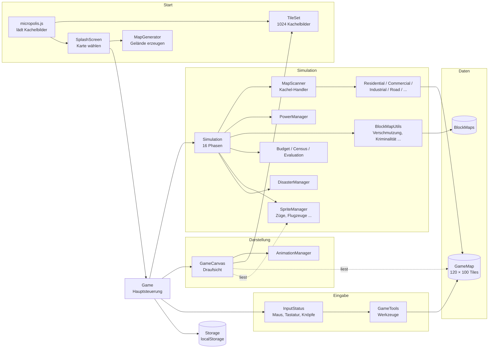
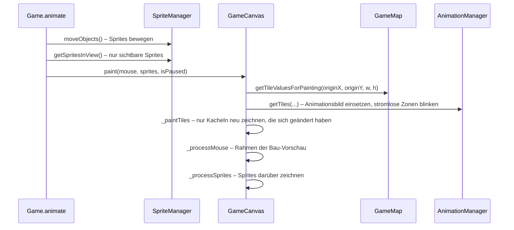
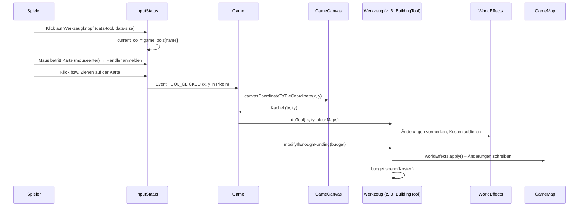

# Architektur von Dorfplaner

Stand: 22.11.2026 · Grundlage: micropolisJS Commit `f13a162` plus Dorfplaner-Änderungen bis `dc82335`
Zielgruppe: Oberstufe. Wer den Code zum ersten Mal öffnet, soll hiermit wissen, wo was passiert.

## 0. Ein paar Begriffe vorweg

| Begriff | Bedeutung |
|---|---|
| **Kachel** (engl. *tile*) | Ein Feld der Karte, wie ein Kästchen auf Karopapier. Die Stadt besteht aus 120 × 100 Kacheln. |
| **Kachelwert** | Eine Zahl, die sagt, *was* auf der Kachel ist (Wasser, Straße, Teil eines Hauses …). |
| **Flag / Bit** | Ein einzelnes Ja/Nein-Merkmal, das als Bit in einer Zahl gespeichert ist (z. B. „hat Strom“). |
| **Canvas** | HTML-Element, auf das JavaScript Pixel zeichnen kann – die „Leinwand“ des Spiels. |
| **Sprite** | Ein bewegtes Bild, das *über* den Kacheln liegt: Zug, Flugzeug, Schiff, Monster, Tornado. |
| **Modul** | Eine Quelldatei, die Funktionen bereitstellt (`export`) und andere benutzt (`import`). |
| **Bundler (webpack)** | Werkzeug, das alle Module zu einer einzigen Datei `micropolis.js` für den Browser zusammenpackt. |
| **Event** | Eine Nachricht „etwas ist passiert“, auf die andere Teile reagieren können (z. B. `TOOL_CLICKED`). |
| **BlockMap** | Eine grobe Zusatzkarte, bei der ein Wert für einen ganzen Block von 2×2, 4×4 oder 8×8 Kacheln gilt (z. B. Verschmutzung). |

## 1. Überblick

Das Spiel besteht aus drei Schichten, die nur über klar definierte Stellen miteinander sprechen:

1. **Simulation** – rechnet, wie die Stadt wächst. Kennt nur Zahlen, keine Pixel.
2. **Darstellung** – liest die Karte und zeichnet sie auf ein Canvas.
3. **Eingabe und Bedienung** – übersetzt Maus und Tastatur in Werkzeugaktionen und öffnet Fenster.

Die Simulation und das Zeichnen laufen in **zwei getrennten Schleifen**: Die Simulation wird mit `setTimeout`
immer wieder angestoßen, das Zeichnen mit `requestAnimationFrame` (einmal pro Bildschirmbild, meist 60-mal pro
Sekunde). Genau diese Trennung macht die isometrische Ansicht möglich, ohne die Simulation anzufassen.



## 2. Verzeichnisse und Module

```
stadt/
├── index.html, about.html, name_license.html   Seiten mit allen Fenstern (Budget, Abfrage, …) als verstecktes HTML
├── css/style.css                               Aussehen der Bedienelemente
├── images/tiles.png, tilessnow.png             1024 Kachelbilder (32 × 32 Raster à 16 × 16 px), Sommer und Winter
├── images/sprites.png, sprites/                Bilder für Sprites
├── src/                                        Quellcode (90 Dateien, ca. 13.500 Zeilen)
├── test/                                       Unit-Tests (Jest) für die TypeScript-Hilfsklassen
├── webpack.config.js, package.json             Build
└── docs/                                       diese Dokumentation
```

Die Module in `src/`, nach Aufgabe gruppiert:

| Gruppe | Dateien | Aufgabe |
|---|---|---|
| **Start** | `micropolis.js` | Einstiegspunkt: lädt Kachelbilder, startet den `SplashScreen` |
| | `splashScreen.js`, `splashCanvas.js`, `mapGenerator.js` | Startbildschirm, Vorschau, Zufallskarte (Flüsse, Seen, Wälder) |
| | `game.js` | **Hauptsteuerung**: baut Simulation, Canvas, Eingabe und Fenster zusammen, enthält die beiden Schleifen `tick` und `animate` |
| **Daten** | `gameMap.js` | die Karte: Liste aller Kacheln, Lesen/Schreiben, Speichern/Laden |
| | `tile.ts`, `tileFlags.ts`, `tileValues.ts`, `tileUtils.js` | eine Kachel, ihre Bits und die Bedeutung aller 1024 Kachelwerte |
| | `blockMap.ts`, `blockMapUtils.js` | grobe Zusatzkarten und die Rechnungen darauf |
| | `position.ts`, `direction.ts`, `bounds.ts` | Koordinaten, Himmelsrichtungen, Rechtecke |
| | `storage.js` | Speichern im Browser (`localStorage`) |
| **Simulation** | `simulation.js` | Taktgeber: 16 Phasen, ruft alle Teilsysteme auf |
| | `mapScanner.js` | geht die Karte durch und ruft je Kachelart den passenden Handler |
| | `residential.js`, `commercial.js`, `industrial.js`, `zoneUtils.js` | Wachsen und Schrumpfen der Zonen |
| | `powerManager.js` | Stromnetz: welche Kacheln sind mit einem Kraftwerk verbunden |
| | `traffic.js`, `road.js`, `transport.js` | Verkehr: Fahrten von Zonen zu Zielen, Straßen- und Schienenverschleiß |
| | `emergencyServices.js`, `stadia.js`, `miscTiles.js` | Polizei, Feuerwehr, Stadion, Sonstiges (Feuer, Überflutung, Radioaktivität) |
| | `census.js`, `budget.js`, `evaluation.js`, `valves.js` | Volkszählung, Haushalt/Steuern, Bewertung, Nachfrage (R/C/I-„Ventile“) |
| | `disasterManager.js`, `repairManager.js` | Katastrophen; Reparatur beschädigter Zonen |
| | `spriteManager.js`, `*Sprite.js`, `spriteUtils.js`, `spriteConstants.ts` | bewegte Objekte |
| **Darstellung** | `gameCanvas.js` | zeichnet Karte, Sprites und Bau-Vorschau auf das Canvas (Draufsicht) |
| | `tileSet.js`, `tileSetURI.ts`, `tileSetSnowURI.ts` | zerlegt `tiles.png` in 1024 Einzelbilder; Ersatz als eingebettete Daten-URI |
| | `animationManager.js`, `tileHistory.js` | Animationen (Verkehr, Rauch, Feuer, Radar) und Blinken stromloser Zonen |
| | `mouseBox.js` | Rahmen der Bau-Vorschau |
| | `monsterTV.js` | kleines zweites Kartenfenster, das Katastrophen verfolgt |
| **Eingabe** | `inputStatus.js` | Maus, Tastatur, Werkzeugknöpfe → Events |
| | `gameTools.js`, `baseTool.js`, `connectingTool.js`, `connector.js` | Werkzeug-Liste, Grundfunktionen, Anschluss an Nachbarstraßen |
| | `buildingTool.js`, `roadTool.js`, `railTool.js`, `wireTool.js`, `parkTool.js`, `bulldozerTool.js`, `queryTool.js` | die einzelnen Werkzeuge |
| | `worldEffects.js` | Zwischenspeicher: ein Werkzeug sammelt Änderungen erst hier, bevor sie auf die Karte kommen |
| **Fenster / Anzeigen** | `*Window.js`, `modalWindow.js`, `infoBar.js`, `rci.js`, `notification.js`, `text.js` | Budget, Bewertung, Einstellungen, Abfrage, Infoleiste, R/C/I-Balken, Meldungen, Texte |
| **Hilfen** | `eventEmitter.js`, `messages.ts`, `miscUtils.js`, `random.ts`, `config.js`, `debugAssert.ts` | Event-System, Nachrichtennamen, Zufall, Debug-Schalter |

## 3. Datenmodell der Karte

### 3.1 Die Karte als Liste

`GameMap` (`src/gameMap.js`) speichert **120 × 100 = 12.000 Kacheln** in einer einfachen Liste (`this._data`).
Die zweidimensionale Position (x, y) wird in eine Listenposition umgerechnet:

```
index = x + y * width        // z. B. (5, 2) → 5 + 2 * 120 = 245
```

x läuft nach rechts (0–119), y nach unten (0–99). Die Ecke (0, 0) ist oben links.

### 3.2 Eine Kachel = eine 16-Bit-Zahl

Jede Kachel (`src/tile.ts`) speichert **eine einzige Zahl**. Darin stecken zwei Dinge:

```
Bit:   15   14   13   12   11   10 | 9 8 7 6 5 4 3 2 1 0
       PWR  CND  BRN  BUL  ANI  ZON | Kachelwert 0–1023
```

| Bit | Name | Bedeutung |
|---|---|---|
| 15 | `POWERBIT` | Kachel hat Strom |
| 14 | `CONDBIT` | leitet Strom weiter (Leitungen, Gebäude) |
| 13 | `BURNBIT` | kann brennen |
| 12 | `BULLBIT` | kann abgerissen werden |
| 11 | `ANIMBIT` | wird animiert |
| 10 | `ZONEBIT` | **Mittelkachel** einer Zone oder eines Gebäudes |

Die unteren 10 Bits ergeben den **Kachelwert** (0–1023). Er bestimmt, welches Bild gezeichnet wird und wie die
Simulation die Kachel behandelt. Wichtige Bereiche aus `src/tileValues.ts`:

| Kachelwerte | Inhalt |
|---|---|
| 0 | `DIRT` – freies Land |
| 2–20 | Wasser und Ufer |
| 21–43 | Wald |
| 44–63 | Trümmer, Überflutung, Radioaktivität, Feuer |
| 64–206 | Straßen: Brücken, Kurven, Kreuzungen, je Stufe ohne / wenig / viel Verkehr |
| 208–222 | Stromleitungen |
| 224–238 | Schienen |
| 240–422 | Wohnen (leere Zone, Einzelhäuser, 16 Ausbaustufen), Krankenhaus, Kirche |
| 423–611 | Gewerbe (leere Zone, 20 Ausbaustufen) |
| 612–692 | Industrie (leere Zone, 8 Ausbaustufen) |
| 693–826 | Hafen, Flughafen, Kohle- und Kernkraftwerk, Feuerwehr, Polizei, Stadion |
| darüber | Animationsbilder (Rauch, Radar, Brücken, Explosionen …) |

### 3.3 Gebäude aus mehreren Kacheln

Eine Wohnzone ist 3 × 3 Kacheln groß, ein Kraftwerk 4 × 4, der Flughafen 6 × 6. Auf der Karte stehen dafür
**9, 16 bzw. 36 verschiedene Kachelwerte** nebeneinander – jedes Teilstück hat sein eigenes Bild, zusammen ergibt
sich das Gebäude wie ein Mosaik. Nur die **Mittelkachel** trägt das `ZONEBIT`; die Simulation arbeitet nur mit
ihr. `GameMap.putZone()` und `zoneUtils.putZone()` schreiben alle Teilstücke auf einmal; `zoneUtils.checkZoneSize()`
liefert zu einem Kachelwert die Gebäudegröße.

> Für die Isometrie heißt das: Ein Gebäude muss als **ein** Bild an seiner Mittelkachel gezeichnet werden, die
> übrigen Teilstücke nur als Boden (siehe Abschnitt 8).

### 3.4 Zusatzkarten (BlockMaps)

Neben der Kachelkarte hält die Simulation grobe Karten (`simulation.js`, `this.blockMaps`). Ein Wert gilt für einen
ganzen Block:

| BlockMap | Blockgröße | Wertebereich | Bedeutung |
|---|---|---|---|
| `populationDensityMap` | 2 | 0–510 | Bevölkerungsdichte |
| `trafficDensityMap` | 2 | 0–240 | Verkehrsaufkommen |
| `pollutionDensityMap` | 2 | 0–255 | Verschmutzung |
| `landValueMap` | 2 | 0–250 | Bodenwert |
| `crimeRateMap` | 2 | 0–250 | Kriminalität |
| `terrainDensityMap` | 4 | 0–240 | wie unberührt das Gelände ist |
| `fireStationEffectMap`, `policeStationEffectMap` | 8 | 0–1000 | Abdeckung durch Feuerwehr / Polizei |
| `rateOfGrowthMap` | 8 | −200–200 | Wachstumsrate |
| `cityCentreDistScoreMap` | 8 | −64–64 | Abstand zum Stadtzentrum |

Diese Karten werden **nur gelesen**, wenn wir später eine Übersichtskarte mit Einblendungen bauen.

### 3.5 Speichern

Im Original legt `storage.js` genau einen Spielstand als JSON in `localStorage` unter dem Schlüssel
`micropolisJSGame` ab (Version 3). `GameMap.save()` schreibt jede Kachel als `{value: <16-Bit-Zahl>}`. Ältere
Versionen werden beim Laden über `transitionOldSave()` angehoben – an dieser Stelle hängen wir später die Höhenkarte
an (Version 5; Version 4 ist inzwischen die Wasserversorgung, siehe 4.4).

**Dorfplaner: mehrere Spielstände.** Der Inhalt eines Spielstands bleibt unverändert; neu ist nur die Ablage:

| Schlüssel | Inhalt |
|---|---|
| `dorfplaner.saves` | Verzeichnis: Kennung, Name, Spielzeit, Einwohner, gespeichert am – ohne Karte |
| `dorfplaner.save.<id>` | ein vollständiger Spielstand (rund 160 KB, der Browser erlaubt meist etwa 5 MB) |
| `micropolisJSGame` | alter Einzel-Spielstand; wird einmalig als Spielstand „alt“ übernommen und bleibt liegen |

Die reinen Rechenfunktionen (Verzeichnis pflegen, Datei prüfen, Dateiname) stehen in `saveSlots.ts` und haben
Unit-Tests. Der Export als Datei verpackt den Spielstand in `{format: "dorfplaner-spielstand", formatVersion: 1,
game: …}`; der Import prüft Aufbau, Kartengröße und Version, bevor etwas gespeichert wird. Die Datei wird nur im
Browser gelesen bzw. erzeugt – es geht nichts an einen Server.

## 4. Ablauf eines Simulationsschritts

### 4.1 Der Takt

`Game` ruft in der Funktion `tick` (`src/game.js`) immer wieder `simulation.simTick()` auf, angestoßen über
`setTimeout(…, 0)`. `simTick()` → `_simFrame()` prüft zuerst, ob seit dem letzten Schritt genug Zeit vergangen ist:

| Tempo | Mindestabstand | einstellbar über |
|---|---|---|
| langsam | 100 ms | Fenster *Settings* |
| mittel (Standard) | 50 ms | Fenster *Settings* |
| schnell | 10 ms | Fenster *Settings* |
| Pause | – | Knopf *Pause* |

Jeder Aufruf erledigt **eine von 16 Phasen** (`simulate()` in `simulation.js`). Ein voller Durchlauf aller 16
Phasen erhöht die Stadtzeit `_cityTime` um 1. **4 Schritte = 1 Monat, 48 Schritte = 1 Jahr** (`getDate()`).

### 4.2 Die 16 Phasen

| Phase | Was passiert | Teilsystem |
|---|---|---|
| 0 | Stadtzeit +1; jede zweite Runde Nachfrage neu berechnen (`valves.setValves`); Zähler der Volkszählung zurücksetzen | Valves, Census |
| 1–8 | **Karte in 8 Streifen abarbeiten** (`mapScanner.mapScan`), je 15 Spalten: für jede Kachel ab Wert 48 Strom vormerken, Zonen zählen und den passenden Handler aufrufen | Zonen, Verkehr, Kraftwerke, Feuer … |
| 9 | Volkszählung (alle 4 bzw. 40 Schritte); **alle 48 Schritte Steuern einnehmen und Stadt bewerten** | Census, **Budget**, Evaluation |
| 10 | Wachstums- und Verkehrskarte abklingen lassen; Meldungen an die Spieler (z. B. „mehr Wohngebiete nötig“) | BlockMaps, Meldungen |
| 11 | **Stromnetz** neu berechnen | PowerManager |
| 12 | **Verschmutzung**, Geländedichte und **Bodenwert** | BlockMapUtils |
| 13 | **Kriminalität** | BlockMapUtils |
| 14 | Bevölkerungsdichte | BlockMapUtils |
| 15 | Feuerwehr-Abdeckung; **Katastrophen** auslösen | BlockMapUtils, DisasterManager |

Die Phasen 11–15 laufen nicht in jeder Runde, sondern je nach Tempo nur jede n-te Runde (Tabellen
`speedPowerScan`, `speedCrimeScan` … in `simulation.js`). Bei hohem Tempo wird also seltener neu gerechnet.

### 4.3 Wie eine Zone wächst (Phase 1–8 im Detail)

`MapScanner` (`src/mapScanner.js`) kennt eine Liste von Paaren *„Bedingung → Handler“*. Beim Start meldet jedes
Teilsystem seine Handler an (`registerHandlers`). Trifft der Scanner zum Beispiel auf eine Wohnzonen-Mittelkachel,
ruft er `residentialFound()` in `residential.js` auf. Diese Funktion

1. versucht über `Traffic.makeTraffic()` eine Fahrt über die Straßen von der Zone zu einer **Gewerbezone** und
   schreibt dabei Verkehr in die `trafficDensityMap`,
2. bewertet die Lage (`evalResidential`): Bodenwert minus Verschmutzung; ohne erreichbare Straße gibt es −3000 Punkte,
3. addiert die Nachfrage nach Wohnraum (`valves.resValve`) und lässt die Zone zufallsabhängig wachsen (`growZone`)
   oder verfallen (`degradeZone`) – dabei werden neue Kachelwerte für die nächste Ausbaustufe auf die Karte geschrieben.

Gewerbe und Industrie funktionieren genauso, nur mit anderen Fahrtzielen. Zusammen ergibt sich ein Kreislauf:

```
Wohnen ──fährt zu──▶ Gewerbe ──fährt zu──▶ Industrie ──fährt zu──▶ Wohnen
```

Der **Verkehr** ist damit kein eigener Schritt, sondern entsteht beim Abarbeiten der Zonen.

### 4.4 Dorfplaner: Wasserversorgung

Nach dem Vorbild des Stromnetzes (`powerManager.js`), aber als eigener Baustein:

| Datei | Aufgabe |
|---|---|
| `src/water/waterRules.ts` | reine Regeln mit Unit-Tests: Pumpenleistung, Bilanz mit Wassertürmen, Netzsuche, Wachstumsgrenze, Schonfrist, Kodierung der Rohrkarte |
| `src/waterManager.js` | Rohrkarte (`pipeMap`), Ergebnis je Kachel (`waterGridMap`), Turmfüllstände; `doWaterScan()` in Phase 11 direkt nach der Strom-Berechnung |
| `src/waterTools.js` | Werkzeuge Wasserrohr (schreibt in die Rohrkarte, nicht auf die Kachel), Pumpe, Wasserturm |
| `src/water/waterIcons.ts` | Tropfen, Rohrfarben – gemeinsam für Draufsicht und 3D-Ansicht |

Regeln: Wasser fließt von Pumpen (mit Strom; am Wasser doppelte Leistung) und Türmen durch Rohre **und Gebäude**.
Jede Gebäudekachel verbraucht eine Einheit. Türme füllen sich mit Überschuss und geben bei Engpässen ab.
Wohn-, Gewerbe- und Industriezonen ohne Wasser wachsen nur bis Stufe 1; dichtere fallen nach einer Schonfrist
(1 Spieljahr, auch nach dem Laden eines alten Spielstands) gelegentlich eine Stufe zurück.

Eingriffe in die Simulation (mit Freigabe): neuer Schritt in `simulation.js`, Zählung in `mapScanner.js`/`census.js`,
je eine Abfrage in `residential.js`, `commercial.js`, `industrial.js`. Neue Kachelwerte `PUMP = 1020` und
`WATER_TOWER = 1021` (die letzten freien Nummern; ihre Draufsicht-Bilder zeichnet `tileSet.js` selbst).
Speicherformat Version 4: zusätzlich `pipes` (Lauflängen-Text), `waterTowers`, `waterGraceUntil`.

### 4.5 Ergebnisse nach außen

Die Simulation zeichnet nichts. Sie schickt **Events** (`messages.ts`) wie `FUNDS_CHANGED`, `DATE_UPDATED`,
`VALVES_UPDATED` oder `FRONT_END_MESSAGE`. `Game` hört darauf und aktualisiert Infoleiste, R/C/I-Balken und
Meldungen.

## 5. Rendering-Pipeline (Draufsicht)

### 5.1 Woher die Bilder kommen

1. `micropolis.js` nimmt das `` aus `index.html` (Datei `images/tiles.png`, 512 × 512 px).
2. `TileSet` (`src/tileSet.js`) prüft die Größe und schneidet sie in **1024 kleine Canvas à 16 × 16 px**,
   abrufbar als `tileSet[kachelwert]`. Dasselbe passiert mit `tilessnow.png` für den Winter.
3. Klappt das nicht (z. B. beim Öffnen als lokale Datei), lädt es eine eingebettete Kopie aus `tileSetURI.ts`.
4. Sprites kommen aus `images/sprites.png` (Bilder à 48 × 48 px, je Zeile ein Sprite-Typ, je Spalte ein Bild).

### 5.2 Ein Bild zeichnen

`Game` ruft über `requestAnimationFrame` die Funktion `commonAnimate` auf. Pro Bildschirmbild:



Wichtige Eigenschaften der Draufsicht:

- **Ausschnitt:** `_originX/_originY` ist die Kachel oben links im Fenster. Gezeichnet wird nur, was sichtbar ist.
- **Sparsames Zeichnen:** `_paintTiles` vergleicht mit dem letzten Bild und zeichnet nur geänderte Kacheln neu.
  Wo Sprites oder der Mausrahmen lagen, wird die Kachel als „beschädigt“ (Wert −2) markiert und im nächsten Bild
  neu gezeichnet. Das funktioniert nur, weil sich Kacheln in der Draufsicht **nie überdecken**.
- **Feste Größe:** 16 px pro Kachel, kein Zoom. Pixel ↔ Kachel ist eine einfache Division durch 16.
- **Zweites Fenster:** `monsterTV.js` benutzt eine zweite Instanz von `GameCanvas` für das kleine Verfolgerfenster.

## 6. Eingabe: vom Mausklick zur Werkzeugaktion

### 6.1 Verschieben der Karte

Pfeiltasten oder W/A/S/D setzen in `InputStatus` die Merker `up/down/left/right`. `Game.handleInput()` ruft dann bei
jedem `tick` `gameCanvas.moveNorth()` usw. auf – der Ausschnitt rückt um eine Kachel. **Mit der Maus lässt sich die
Karte nicht verschieben.**

### 6.2 Bauen



Einzelheiten:

- Die Handler für die Karte werden erst bei **`mouseenter`** angemeldet (`inputStatus.js`). Ohne Werkzeug passiert
  beim Klicken nichts.
- **Klick-Werkzeuge** (Gebäude, Zonen, Park, Abriss, Abfrage) reagieren auf `click`. **Zieh-Werkzeuge** (Straße,
  Schiene, Leitung; `isDraggable`) reagieren auf `mousedown` und senden beim Ziehen bei jedem Kachelwechsel ein neues
  `TOOL_CLICKED`. Für diesen Kachelwechsel rechnet `inputStatus.js` selbst mit `mouseX / tileWidth`.
- `WorldEffects` sammelt alle Änderungen eines Klicks. Erst wenn das Geld reicht, werden sie auf die Karte
  geschrieben – sonst verworfen. So entsteht nie ein halb gebautes Gebäude.
- `connector.js` passt dabei benachbarte Straßen-, Schienen- und Leitungsstücke an (Kurven, Kreuzungen).
- Die **Bau-Vorschau** berechnet `Game.calculateMouseForPaint()` über `canvasCoordinateToTileOffset()`;
  Größe und Farbe kommen aus den HTML-Attributen des Werkzeugknopfs (`data-size`, `data-colour`).
- **Touch** wird nicht unterstützt. Beim ersten `touchstart` erscheint nur ein Hinweisfenster.

## 7. Beobachtungen im Bestand (gut für die Präsentation)

| Stelle | Beobachtung | Folge für uns |
|---|---|---|
| `simulation.js`, Phase 9 | `take10Census(budget)` benutzt eine Variable `budget`, die es dort gar nicht gibt. Es funktioniert nur, weil der Browser HTML-Elemente mit einer `id` als globale Variablen anbietet – hier `<div id="budget">`. | Nicht anfassen (Simulation). Merken: Wer im HTML die `id="budget"` umbenennt, legt die Simulation lahm. |
| `micropolis.js` | `$('#snowtiles')[1]` greift auf ein zweites Element zu, das es nicht gibt. Die Winterkacheln kommen deshalb immer aus der eingebetteten Ersatzkopie. | harmlos, aber gutes Beispiel für „läuft trotz Fehler“ |
| `game.js`, `handlePause` | Kommentar: zwischen den Tempostufen gebe es noch keinen echten Unterschied. Tatsächlich ändern sie den Mindestabstand (100/50/10 ms) und die Häufigkeit der Phasen 11–15. | Tempomenü in der neuen Bedienung kann `setSpeed()` direkt nutzen |
| `test/bounds.ts` | Zwei Tests erwarten Prüfungen, die im Code auskommentiert sind; in Dorfplaner übersprungen. | – |
| `gameCanvas.js:352` | wirft in einem Fehlerfall die undefinierte Variable `e` | beim Ersetzen durch `IsoCanvas` nicht übernehmen |
| `residential.js`, `growZone`/`degradeZone` | Die Formeln für die Stufe passen nicht zu `getZonePopulation` (Bevölkerung 24/32/40/48): Beim Wachsen springt ein Wohnblock von Stufe 0 auf 2 bzw. 1 auf 3, beim Rückgang bleibt er auf derselben Stufe. | Nicht verändert (Simulation, eigene Freigabe nötig). Die Wasserregel rechnet die Stufen selbst richtig (`waterRules.ts`). |

## 8. Stellen, die für das Ziel-Feature angepasst werden

Ziel: isometrische Ansicht mit Geländehöhen, umschaltbar zur Draufsicht, und neue Bedienung (Ziehen, Zoom, Drehen,
Touch, Symbolleiste, Menü, Übersichtskarte). Entscheidungen und Begründung: `ANALYSE_ANSICHT_BEDIENUNG.md`.

### 8.1 Darstellung (Simulation unberührt)

| Datei | Anpassung |
|---|---|
| **neu** `src/iso/projection.ts` | reine Rechenfunktionen: Kachel ↔ Bildschirm, Drehung, Picking – mit Unit-Tests |
| **neu** `src/iso/isoCanvas.js` | gleiche öffentliche Methoden wie `GameCanvas` (`init`, `paint`, `centreOn`, `moveNorth` …, `canvasCoordinateToTileCoordinate`, `canvasCoordinateToTileOffset`, `canvasCoordinateToPosition`, `getTileOrigin`, `screenshotVisible/Map`); zeichnet jedes Bild den sichtbaren Ausschnitt komplett neu, von hinten nach vorn |
| **neu** `src/iso/isoTiles.js` | prozedurales Zeichnen der Iso-Kacheln (Boden, Wasser, Netze) und Gebäude; Zwischenspeicher je Zoomstufe |
| **neu** `src/iso/buildingTable.ts` | Zuordnung Kachelwert → Gebäudetyp, Größe, Ausbaustufe; getestet gegen `tileValues.ts` und `zoneUtils.checkZoneSize()` |
| `src/game.js` | Canvas-Wahl (Draufsicht/Isometrie) beim Start und Umschalten zur Laufzeit; `calculateSpritesForPaint` arbeitet bisher mit Pixelbreite der Draufsicht |
| `src/gameCanvas.js` | bleibt für die Draufsicht und `monsterTV`; nur bei Bedarf eine gemeinsame Schnittstelle herausziehen |
| `src/animationManager.js` | wird weiterverwendet (liefert Animationsbilder als Kachelwerte); Iso-Zeichnung muss diese Werte kennen |
| `src/spriteManager.js` | nur gelesen; Sprite-Positionen (Pixel der Draufsicht) werden in Kachelkoordinaten umgerechnet und projiziert |

### 8.2 Eingabe und Bedienung

| Datei | Anpassung |
|---|---|
| `src/inputStatus.js` | Umstellung auf **Pointer Events** (Maus und Finger gemeinsam); Handler nicht erst bei `mouseenter`; Ziehen-Erkennung über die Canvas-Umrechnung statt `mouseX / tileWidth`; Gesten: ein Finger baut, zwei Finger verschieben/zoomen; Mausrad zoomt; Ziehen mit rechter/mittlerer Maustaste verschiebt |
| `src/game.js` | `handleInput`: Tastatur-Verschieben in Bildschirmrichtung, auch nach Drehung; Touch-Hinweis entfernen |
| `index.html`, `css/style.css` | Menüleiste, Statuszeile, Symbolleiste mit eigenen Symbolen, Übersichtskarte, Knöpfe für Drehen/Zoom/Ansicht |
| **neu** `src/ui/minimap.js` | Übersichtskarte, Einblendungen aus `blockMaps` (nur lesen), Klick springt dorthin |
| `src/settingsWindow.js` | Tempo bleibt hier oder wandert ins Menü |

### 8.3 Geländehöhen (bewusster Eingriff außerhalb des Simulationskerns)

| Datei | Anpassung |
|---|---|
| `src/gameMap.js` | zusätzliche Höhenkarte (eigene Liste), `getHeight/setHeight`; `save/load` erweitern |
| `src/mapGenerator.js` | Höhen erzeugen; Wasser nur in Senken |
| `src/buildingTool.js`, `roadTool.js`, `railTool.js`, `wireTool.js`, `parkTool.js` | Bauregeln am Hang (Gebäude nur eben, Netze max. 1 Stufe) |
| **neu** Werkzeug „Planieren“ | Gelände angleichen gegen Geld |
| `src/storage.js` | Version 5, alte Spielstände mit Höhe 0 laden |
| `src/iso/*` | Hangkacheln zeichnen, Picking mit Höhe |

Nicht angefasst werden: Strom-, Verkehrs-, Budget- und Bewertungslogik. Bisherige begründete und freigegebene
Eingriffe: Verkehrsfehler in `traffic.js` und die Wasserversorgung (4.4). Weitere Eingriffe nur nach Begründung
und Freigabe.
