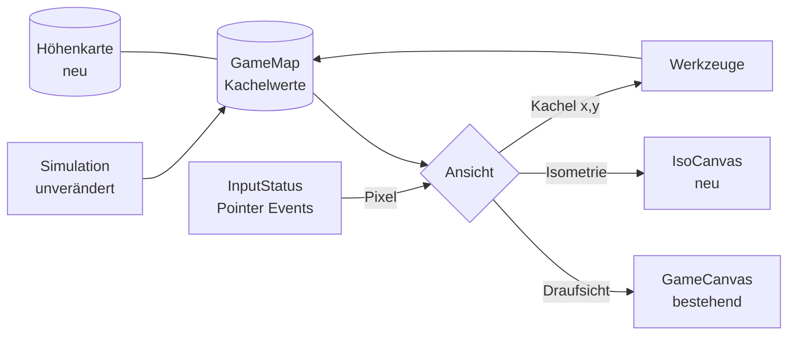

# Umsetzungsplan: isometrische Ansicht, Geländehöhen, neue Bedienung

Stand: 22.11.2026 · Grundlage: `ARCHITEKTUR.md` (Ist-Stand) und `ANALYSE_ANSICHT_BEDIENUNG.md` (Entscheidungen)

## 1. Ziel in einem Satz

Dorfplaner bekommt eine **umschaltbare isometrische Ansicht mit Geländehöhen** und eine **Bedienung für Maus und
Touch** (Verschieben, Zoom, Drehen, Symbolleiste, Menü, Übersichtskarte). Der Simulationskern
(`simulation.js`, `mapScanner.js`, Zonen, Strom, Verkehr, Budget, Bewertung) bleibt unverändert.

## 2. Grundprinzip: Die Simulation merkt nichts

Die Darstellung ist schon heute von der Simulation getrennt (`ARCHITEKTUR.md`, Abschnitt 1). Wir nutzen das so:



- `IsoCanvas` bekommt **dieselben öffentlichen Methoden** wie `GameCanvas`. `Game` und die Werkzeuge rufen
  weiterhin `canvasCoordinateToTileCoordinate()` usw. auf und bekommen eine Kachel zurück – egal welche Ansicht
  aktiv ist.
- Die Höhenkarte liegt **neben** den Kachelwerten, nicht darin. Die Simulation liest nur Kachelwerte und bleibt
  dadurch unberührt.

## 3. Technischer Ansatz

### 3.1 Koordinaten und Projektion

Drei Koordinatensysteme:

| System | Bedeutung |
|---|---|
| **Karte** (x, y) | wie in `GameMap`: x nach rechts 0–119, y nach unten 0–99 |
| **Ansicht** (vx, vy) | die Karte nach Drehung um r · 90° (r = 0…3) |
| **Bildschirm** (sx, sy) | Pixel im Canvas |

**Drehung** (Karte → Ansicht), W = 120, H = 100:

| r | vx | vy | Größe der Ansicht |
|---|---|---|---|
| 0 | x | y | W × H |
| 1 | H−1−y | x | H × W |
| 2 | W−1−x | H−1−y | W × H |
| 3 | y | W−1−x | H × W |

**Projektion** (Ansicht → Bildschirm, obere Spitze der Raute), mit Rautenbreite TW, Rautenhöhe TH = TW/2,
Höhenstufe HS und Höhe h der Kachel:

```
sx = (vx − vy) · TW/2 + ox
sy = (vx + vy) · TH/2 − h · HS + oy
```

`ox, oy` verschieben die ganze Karte (Scrollen). Zoom ändert nur TW (32, 64 oder 128 px). Vorschlag: HS = TW/8,
also 8 px je Höhenstufe bei Zoom 64.

**Umkehrung** für eine angenommene Höhe h (Bildschirm → Ansicht):

```
a = (sx − ox) / (TW/2)
b = (sy − oy + h · HS) / (TH/2)
vx = floor((a + b) / 2)
vy = floor((b − a) / 2)
```

Beides wurde vorab nachgerechnet: Hin- und Rückweg der Drehung für alle 12.000 Kacheln und alle 4 Richtungen,
Picking an 20.000 Zufallspunkten innerhalb der Rauten mit Höhen 0–15 – jeweils ohne Abweichung. Diese Prüfungen
werden als Unit-Tests übernommen.

### 3.2 Höhenmodell

- Höhen werden an den **Ecken** der Kacheln gespeichert, nicht pro Kachel: ein Raster von 121 × 101 Werten,
  Höhe 0–15. So entstehen glatte Hänge; eine Kachel ist **eben**, wenn alle vier Ecken gleich hoch sind.
- Zwei benachbarte Ecken unterscheiden sich höchstens um 1 Stufe (sonst entstünde eine Klippe; die sparen wir uns
  zunächst).
- Aus den vier Eckhöhen ergibt sich die **Kachelform**: eben, Hang in eine von 4 Richtungen, Ecke hoch/tief usw.
  Für das Zeichnen wird jede Form als eigenes kleines Bild zwischengespeichert.
- Wasser liegt immer auf Höhe 0; der Kartengenerator lässt das Land vom Ufer aus ansteigen.

### 3.3 Zeichenreihenfolge (Painter's Algorithm)

„Painter's Algorithm“ heißt: wie ein Maler von hinten nach vorn malen, damit Vorderes Hinteres verdeckt.

1. Sichtbaren Ausschnitt bestimmen: die vier Bildschirmecken per Umkehrformel in Ansichtskoordinaten umrechnen,
   Rand um die maximale Gebäude- und Geländehöhe erweitern.
2. Kacheln nach **vx + vy aufsteigend** durchgehen (Diagonale für Diagonale von hinten nach vorn).
3. Je Kachel: erst den Boden (mit Hangform), dann den Teil des Gebäudes, der **über dieser Kachel** steht.

**Gebäude aus mehreren Kacheln** werden nicht als ein großes Bild gezeichnet, sondern als Stapel je Kachel:
Jede Kachel des Gebäudes zeichnet ihr Stück Dach und – wenn sie am vorderen Rand liegt – die sichtbaren
Seitenwände. Weil damit jedes Objekt genau eine Kachel belegt, ist die Reihenfolge nach vx + vy immer richtig;
es gibt keine Überlappungsfehler zwischen großen und kleinen Gebäuden. Das passt zu unseren selbst gezeichneten
Quader-Gebäuden. Welche Kachel zu welchem Gebäude gehört, steht in der Gebäudetabelle (`buildingTable.ts`,
abgeleitet aus `tileValues.ts` und `zoneUtils.checkZoneSize()`).

### 3.4 Picking mit Höhe

Ein Klick kann eine hohe Kachel weiter vorn oder eine tiefe Kachel weiter hinten treffen. Verfahren:

1. Für h = 15, 14, …, 0 die Umkehrformel anwenden. Höheres h ergibt Kacheln **weiter vorn**, die Liste ist also
   von vorn nach hinten sortiert.
2. Für jede Kandidatenkachel prüfen, ob der Klickpunkt in ihrer gezeichneten Oberfläche liegt (Viereck aus den vier
   projizierten Eckpunkten mit ihren Höhen).
3. Der erste Treffer gewinnt, weil er vorn liegt und alles dahinter verdeckt.

Klicks auf eine Hauswand treffen die Kachel, auf der das Haus steht, wenn die Wand zu dieser Kachel gehört;
sonst die Kachel dahinter. Für Bauen und Abfragen ist das üblich und ausreichend.

### 3.5 Zeichnen nur bei Bedarf

Heute zeichnet `GameCanvas` in jedem Bild nur geänderte Kacheln. In der Isometrie überlappen sich Kacheln, deshalb
zeichnen wir den sichtbaren Ausschnitt **komplett** neu – aber **nur wenn nötig**: wenn sich die Karte, der
Ausschnitt, der Zoom, die Drehung, die Maus oder ein Animationsbild (alle 50 ms) geändert hat.

| Zoom (Rautenbreite) | sichtbare Kacheln bei 1920 × 1080 (Obergrenze) |
|---|---|
| 128 px | ca. 500 |
| 64 px | ca. 2.000 |
| 32 px | bis 8.000 |

Bei 32 px wird es auf dem iPad eng. Gegenmaßnahme: Boden in Blöcken von 16 × 16 Kacheln vorzeichnen und als Ganzes
kopieren (nur bei dieser Zoomstufe, Blöcke einzeln, damit Safaris Canvas-Grenzen nicht überschritten werden).
Die ganze Karte als ein Bild (bei 64 px etwa 7.040 × 3.640 px ≈ 25,6 Mio. Pixel) ist für Safari zu groß und
wird nie angelegt; auch das „Foto der ganzen Karte“ bleibt in der Isometrie auf den sichtbaren Ausschnitt begrenzt.

Für scharfe Darstellung auf Retina-Displays wird die Canvas-Größe mit `devicePixelRatio` multipliziert.

### 3.6 Sprites und Animationen

- **Animationen** (Verkehr, Rauch, Radar, Feuer, Blinken stromloser Zonen) liefert weiterhin der bestehende
  `AnimationManager` als Kachelwerte. Die Iso-Zeichnung kennt für jeden dieser Werte eine Darstellung.
- **Sprites** (Zug, Flugzeug, Hubschrauber, Schiff, Monster, Tornado, Explosion): Position kommt in
  Draufsicht-Pixeln (16 px pro Kachel) → durch 16 teilen → Kachelkoordinate mit Nachkommastellen → drehen →
  projizieren. Zunächst als Schicht **über** allen Kacheln gezeichnet; eigene einfache Iso-Grafiken.

### 3.7 Umschalten Draufsicht ↔ Isometrie

- `Game` erzeugt beide Canvas-Objekte; sichtbar ist immer nur eins. Ein Knopf (und Taste `V`) schaltet um.
- Beim Umschalten wird die Kachel in der Bildschirmmitte übernommen (`centreOn`), damit man nicht „springt“.
- `InputStatus` fragt immer das gerade aktive Canvas nach der Kachel. Die Simulation läuft ununterbrochen weiter.
- Die gewählte Ansicht merkt sich der Browser (`localStorage`, nur als Komfort).

### 3.8 Bedienung

| Aktion | Maus / Tastatur | Touch (iPad) |
|---|---|---|
| Bauen | Linksklick, Ziehen bei Straße/Schiene/Leitung | ein Finger: Antippen zeigt die Vorschau, Loslassen baut; Ziehen bei Straße/Schiene/Leitung |
| Karte verschieben | Ziehen mit rechter oder mittlerer Taste, Pfeiltasten/WASD, Bildschirmrand | zwei Finger ziehen |
| Zoom | Mausrad, `+`/`−` | zwei Finger spreizen/zusammenziehen |
| Drehen | Knöpfe ⟲ ⟳, Tasten `Q`/`E` | Knöpfe |
| Abfrage | Werkzeug „Abfrage“ | lange auf eine Kachel drücken |
| Ansicht | Knopf, Taste `V` | Knopf |

Technik: **Pointer Events** (`pointerdown/move/up`) statt Maus-Events, in Safari seit iOS 13 vorhanden. Ein Event-
Typ für Maus, Stift und Finger. `touch-action: none` auf dem Canvas verhindert, dass Safari selbst scrollt oder zoomt.

Oberfläche: Menüleiste (Datei, Tempo, Ansicht, Katastrophen, Fenster), Statuszeile (Stadt, Datum, Geld,
Meldung), senkrechte Symbolleiste mit Gruppen und Untermenüs, Übersichtskarte. **Alle Symbole und Grafiken zeichnen
wir selbst** (SVG im Code), ohne Vorlagen aus anderen Spielen.

## 4. Arbeitspakete

Aufwand: Schätzung in Personenstunden für Umsetzung und Test, Unsicherheit etwa ±50 %. Jedes Paket endet mit einem
lauffähigen Stand, Unit-Tests für die reinen Rechenfunktionen und einem kurzen Bericht.

| AP | Inhalt | Ergebnis | Aufwand |
|---|---|---|---|
| **1** | `src/iso/projection.ts`: Drehung, Projektion, Umkehrung, sichtbarer Ausschnitt; Unit-Tests | getestete Rechenfunktionen, noch nichts sichtbar | 4 h |
| **2** | `IsoCanvas` flach: Boden, Wasser, Ufer, Wald, Straßen, Schienen, Leitungen; Umschalter Draufsicht ↔ Isometrie; Picking flach; Bau-Vorschau als Raute | Stadt isometrisch sichtbar, Bauen funktioniert in beiden Ansichten | 10 h |
| **3** | Gebäudetabelle (getestet) und prozedurale Gebäude: Zonen je Ausbaustufe, Sondergebäude, Stapel-Zeichnung | Gebäude mit Höhe, richtige Überdeckung | 12 h |
| **4** | Animationen, Blinken, Sprites, Brücken, Feuer, Trümmer | alles Sichtbare aus der Draufsicht auch isometrisch | 6 h |
| **5** | Eingabe neu: Pointer Events, Verschieben, Zoom (3 Stufen), Drehen (4 Richtungen), Gesten, Tastatur | am PC und iPad bedienbar | 10 h |
| **6** | Oberfläche: Menüleiste, Statuszeile, Symbolleiste mit eigenen Symbolen, Tempo-Menü — Symbolleiste **erledigt 22.11.2026** (`src/ui/toolIcons.ts`), Rest offen | neue Bedienoberfläche | 8 h |
| **7** | Übersichtskarte mit Einblendungen (Verschmutzung, Kriminalität, Bodenwert, Verkehr, Strom); Klick springt — **erledigt 22.11.2026** (`src/ui/mapWindow.ts`, zusätzlich Wasser, Bevölkerung, Feuerwehr, Polizei) | Überblick über die Stadt | 6 h |
| **8** | Höhenkarte: Datenstruktur in `GameMap`, Kartengenerator, Speichern Version 5, alte Spielstände; Unit-Tests | Gelände mit Höhen in den Daten | 8 h |
| **9** | Höhen zeichnen: Hangformen, Gebäude auf Höhe, Picking mit Höhe | Hügel sichtbar und anklickbar | 10 h |
| **10** | Bauregeln am Hang, Werkzeug „Planieren“, Meldungen | spielbar mit Hügeln | 8 h |
| **11** | Abschluss: Tests Desktop-Browser und iPad-Safari, README „Was wurde erweitert“, `LERNNOTIZEN.md` | präsentationsfertig | 6 h |
| **12–14** | **Wasserversorgung** (nachträglich beauftragt, erledigt 22.11.2026): Rohre, Pumpe, Wasserturm, Netz, Wachstumsgrenze und Rückbau, Untergrundansicht in beiden Ansichten, Tropfen, Speichern Version 4, Meldungen; Unit-Tests | Zonen brauchen Wasser | ≈ 25 h |
| | **Summe** | | **≈ 113 h** |

Reihenfolge wie vorgegeben: erst Gelände und Straßen (AP 2), dann Zonen und Gebäude (AP 3), Höhen erst nach der
fertigen flachen Isometrie (AP 8–10).

### Meilensteine und Veröffentlichung

| Meilenstein | nach AP | Was live geht (`main`, nach Freigabe) |
|---|---|---|
| M1 | 4 | flache Isometrie umschaltbar, Draufsicht bleibt Standard |
| M2 | 7 | neue Bedienung, iPad-tauglich |
| M3 | 10 | Geländehöhen |
| M4 | 11 | Abschlussstand |

Zwischen den Meilensteinen wird nur auf `feature/isometric` gearbeitet; `main` und damit die Live-Seite ändern sich
erst nach Freigabe.

## 5. Risiken

| Risiko | Wahrscheinlichkeit / Wirkung | Gegenmaßnahme |
|---|---|---|
| Zu langsam auf dem iPad bei kleinster Zoomstufe | mittel / mittel | nur bei Bedarf zeichnen, Boden-Blöcke vorzeichnen, Zwischenspeicher je Zoomstufe; früh auf echtem Gerät messen (nach AP 2) |
| Safari-Canvas-Grenzen (Fläche, Gesamtspeicher) | mittel / hoch | nie die ganze Karte als ein Bild; Zwischenspeicher begrenzen und bei Zoomwechsel leeren |
| Fehlerhafte Zuordnung Kachelwert → Gebäude | mittel / mittel | Gebäudetabelle per Unit-Test gegen `tileValues.ts` und `checkZoneSize()` |
| Überdeckungsfehler bei mehrkacheligen Gebäuden | gering / mittel | Stapel-Zeichnung je Kachel (3.3) statt großer Einzelbilder |
| Picking bei Hängen ungenau | mittel / gering | Viereck-Test mit echten Eckhöhen, Unit-Tests; deutliche Bau-Vorschau |
| Simulation setzt Kacheln, die zur Höhe nicht passen (z. B. Überflutung oder Feuer am Hang, Zonen auf frisch geändertem Gelände) | mittel / gering | nur Darstellung anpassen (Überflutung am Hang zeichnen); die Simulation bleibt unverändert, das Verhalten wird in den Lernnotizen erklärt |
| Bauregeln am Hang machen das Spiel schwerer | hoch / gering | Werkzeug „Planieren“; Kartengenerator mit genug ebenen Flächen |
| Gesten-Konflikte (Bauen vs. Verschieben) auf Touch | mittel / mittel | Bauen erst beim Loslassen, zwei Finger immer Navigation, Test auf echtem iPad |
| Alte Spielstände | gering / mittel | Speicherversion 4, Laden alter Stände mit Höhe 0, Unit-Test |
| Umfang zu groß für den Projektzeitraum | mittel / hoch | Meilensteine einzeln präsentierbar; Höhen (M3) sind abtrennbar |

## 6. Prüfen und Testen

- **Unit-Tests (Jest)** für alle reinen Rechenfunktionen: Drehung, Projektion, Umkehrung, Picking mit Höhe,
  sichtbarer Ausschnitt, Gebäudetabelle, Höhengenerator (Nachbarecken höchstens 1 Stufe Unterschied, Wasser auf 0),
  Speicher-Umstellung Version 3 → 4.
- **Im Browser** nach jedem AP: Spiel starten, bauen in beiden Ansichten, Konsole fehlerfrei, keine Anfragen an
  fremde Server.
- **iPad-Safari** spätestens nach AP 2 (Leistung) und nach AP 5 (Bedienung) über die Live-Seite oder einen
  Vorschau-Build.
- **Simulation unverändert:** Nach jedem AP zeigt `git diff main -- stadt/src/simulation.js stadt/src/mapScanner.js`
  keine Änderungen; Zonen-, Strom-, Verkehrs- und Budgetdateien ebenso.

## 7. Offene Punkte vor dem Start von Phase 4

1. Freigabe dieses Plans.
2. Ob Draufsicht oder Isometrie nach M1 die Standardansicht sein soll (Vorschlag: Draufsicht bis M2, dann Isometrie).
3. Ein iPad für Tests nach AP 2 (Modell/iPadOS-Version notieren).
